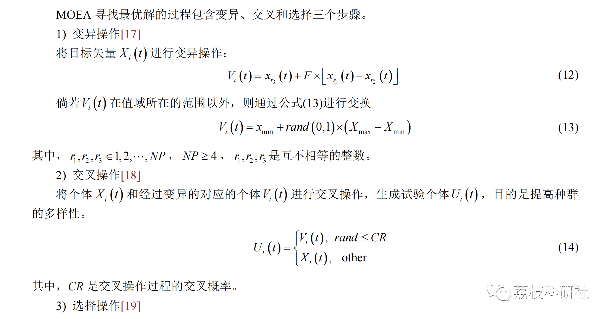
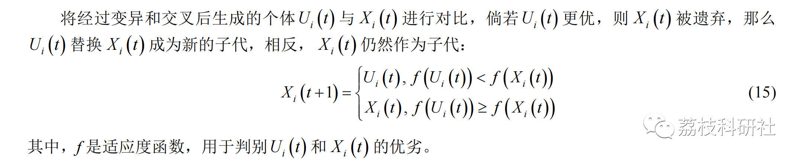
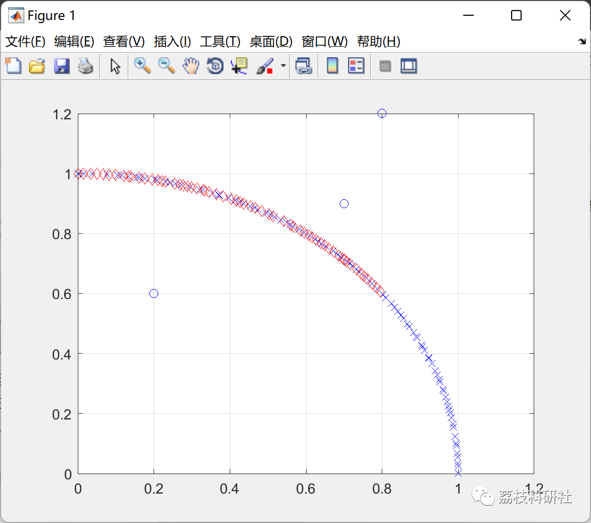
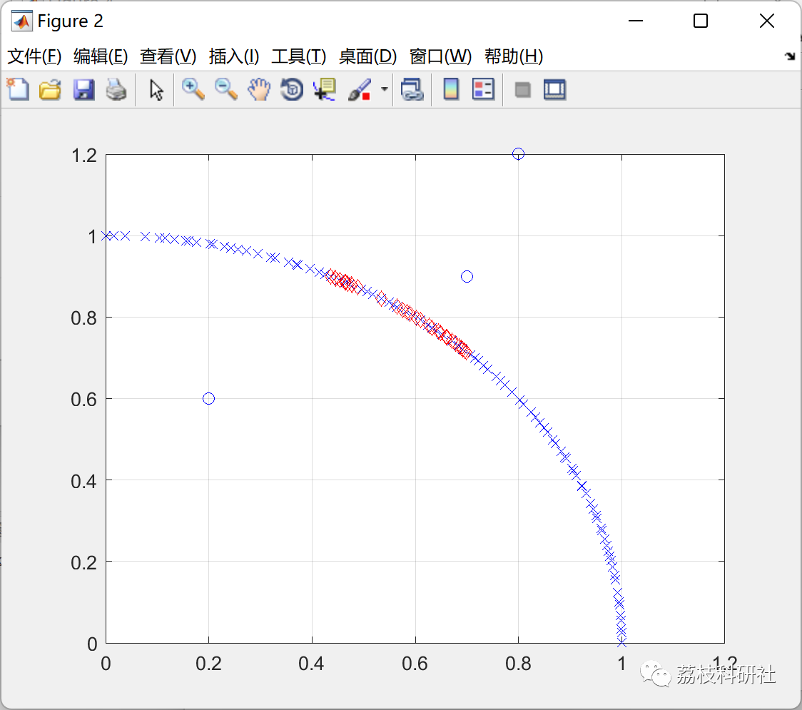
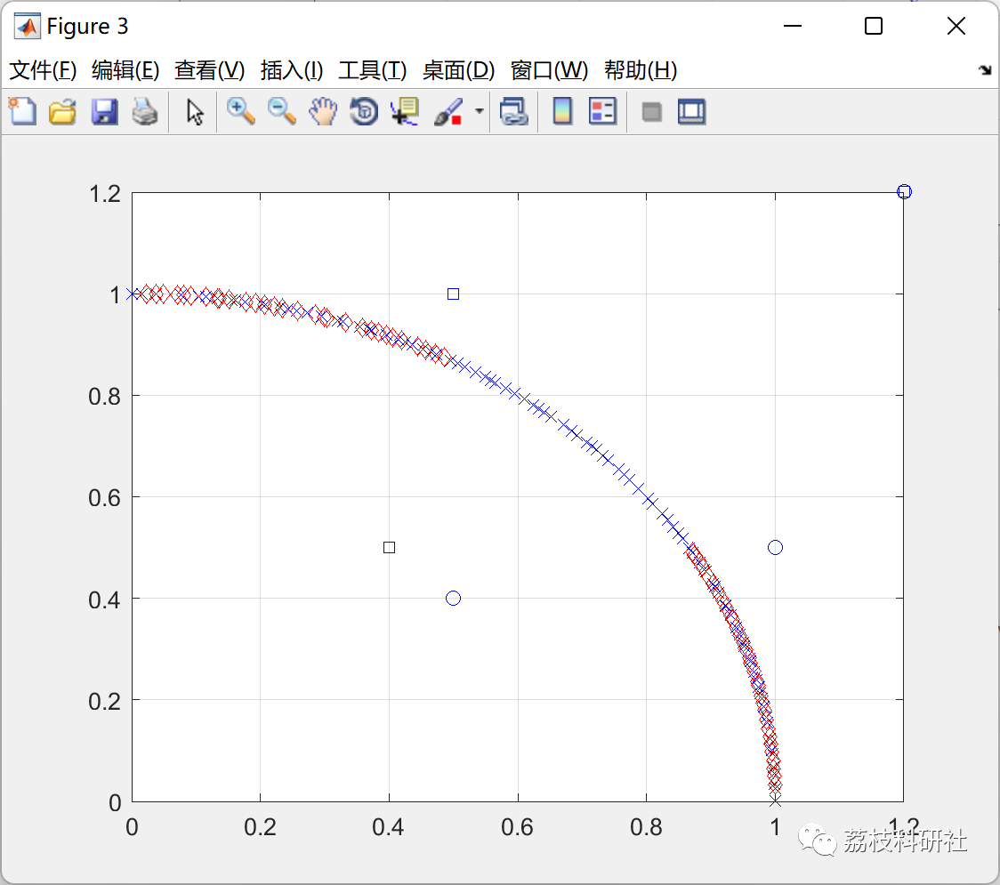
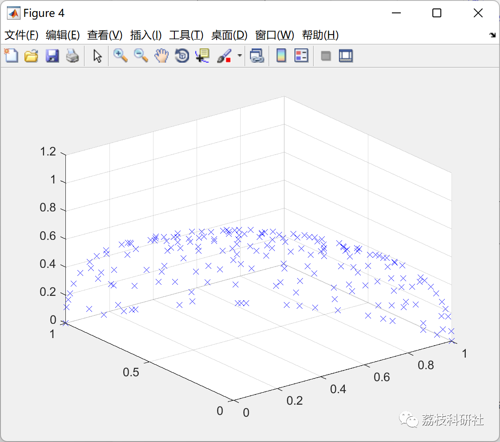
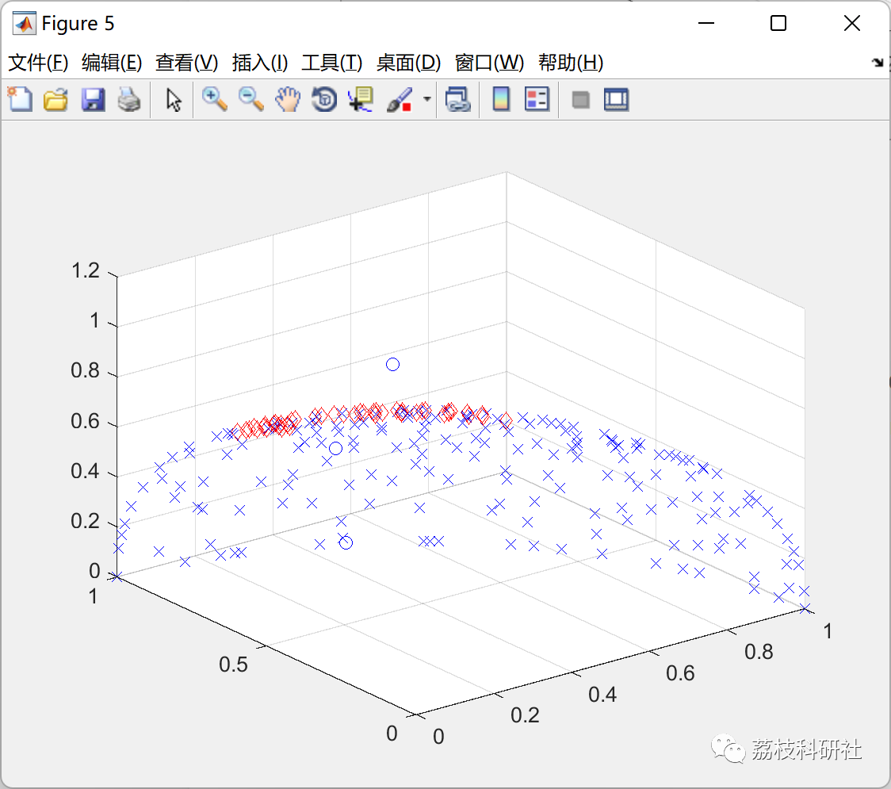
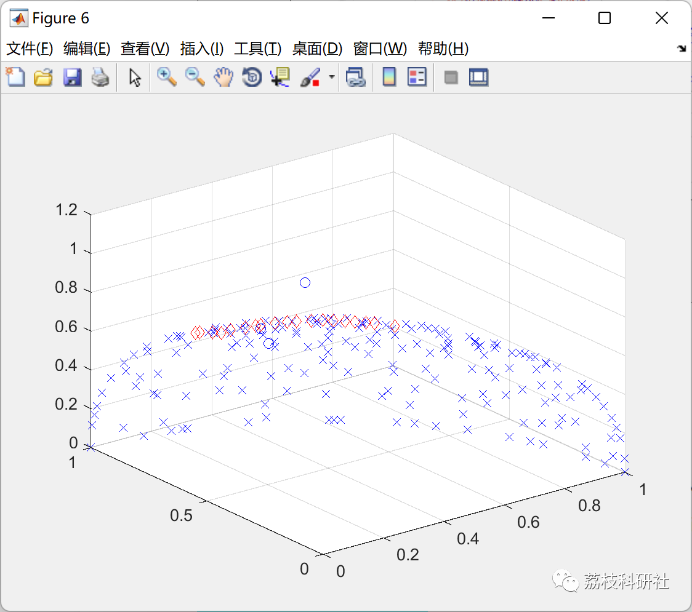
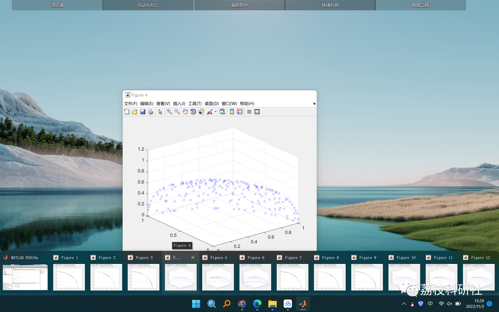

# Preference-based Spherical Pruning Multi-objective Differential Evolution Algorithm (Matlab Code Implementation)

💥💥💥💞💞💞💞 Welcome to this blog❤️❤️❤️💥💥💥
🏆 Bloggers' Advantage: 🌞🌞🌞 The content of the blog strives to be rigorous in thought and clear in logic, for the convenience of readers.
⛳️ Mantra: The journey of a hundred miles is half done in the last ninety.
Litchi Research Society
Code Collection: Power System, Intelligent Algorithms and Applications, Neural Network Prediction, Path Planning, Optimized Scheduling, Workshop Scheduling, Image Processing, Signal Processing...
🎁Column Directory Link:
🌈🌈🌈🌟🌟🌟Electrical Code Intelligent Algorithm and Its Application Path Planning Neural Network Predictive Optimization Scheduling Image Processing Workshop Scheduling Signal Processing Romantic Her My Philosophical Thoughts Math Modeling Complete Code Matters
​  
💥1 Overview
This algorithm is modified on the basis of multi-objective differential optimization algorithm.
📚2 Running Results
🎉3 References
[1]Reynoso-Meza, G., Sanchis, J., Blasco, X., & García-Nieto, S. (2014). Physical programming for preference driven evolutionary multi-objective optimization. Applied Soft Computing, 24, 341-362.  
[2] Wu Changhua, Li Zeqiu. Optimization of Carbon Emission and Production Cost in Steam Power Systems Based on Improved Multi-Objective Differential Evolution [J]. Modeling and Simulation, 2022, 11(3): 829-841
🌈4 Matlab code implementation

## Images

<!-- PAYMENT_BLOCK -->

## Get this dataset

- Payment link (Stripe): [Buy now](https://buy.stripe.com/3cs8yP7sY87d0vu9AB)
- Payment QR code: 

<!-- /PAYMENT_BLOCK -->
